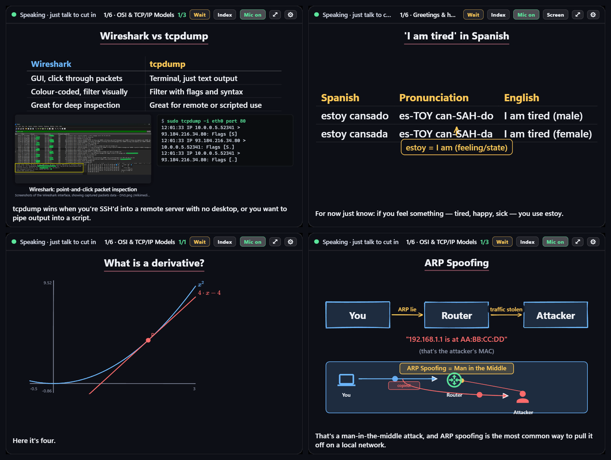
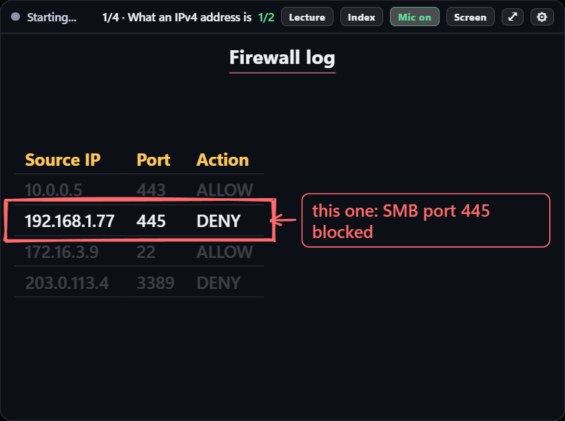
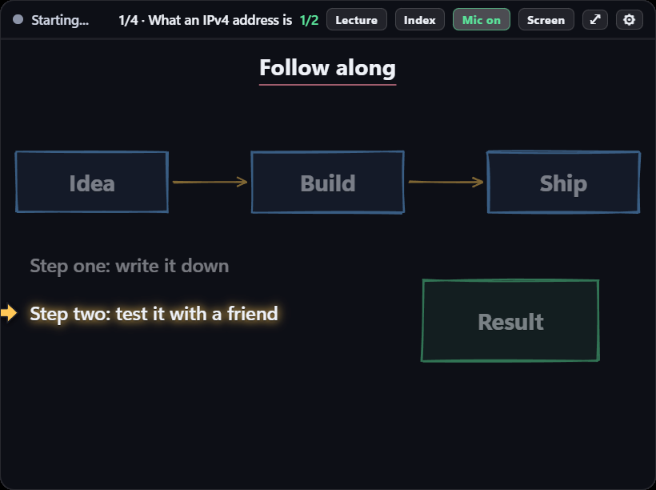
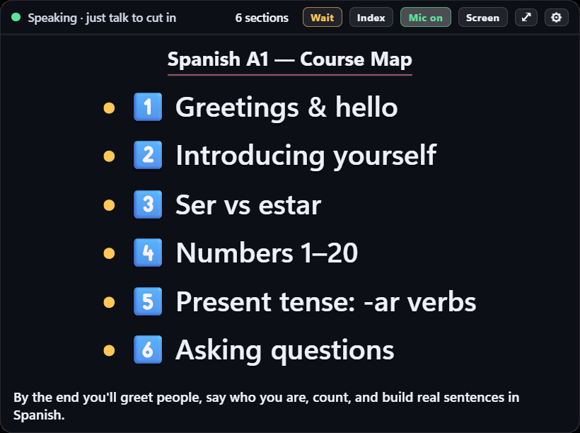
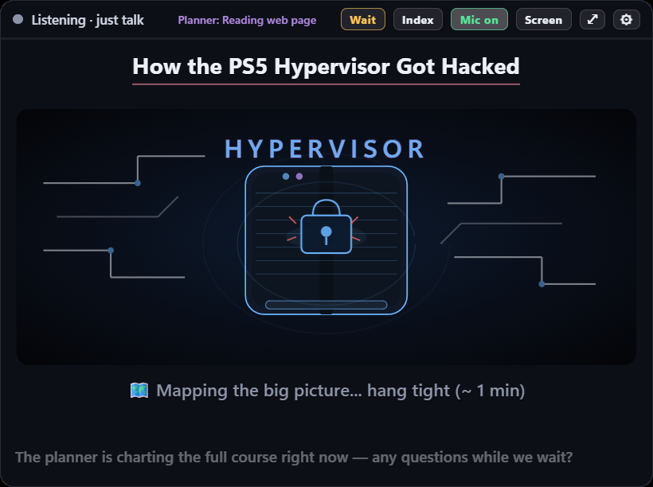
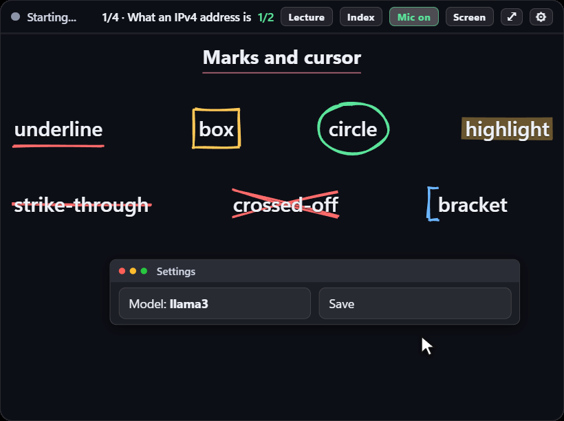
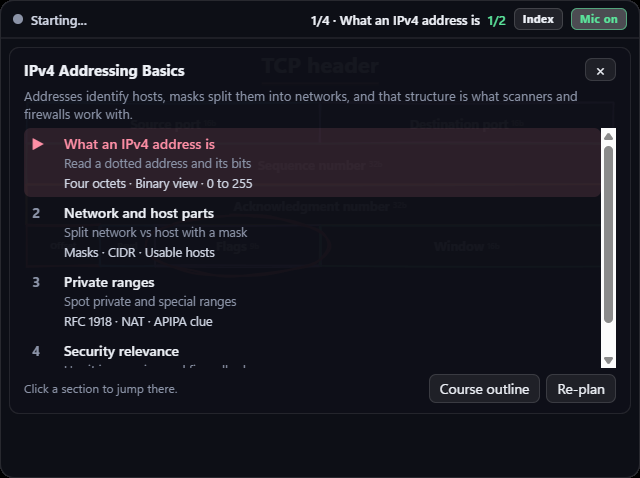

# Sidequest

**An AI voice tutor that sits on top of your game.** Say *"let's learn about X"*, keep
playing, and it teaches you out loud while it draws diagrams, tables, graphs and animated
scenes in a corner of your screen. Each drawing lands in sync with the sentence that explains
it. It's a real conversation with no push-to-talk: talk over it any time to ask a question,
and it quizzes you before moving on.

It works for any subject: a language, calculus, history, networking, a certification you're
studying for, how to run AI models locally, or the notes you drop on it.



> Windows only. Sidequest runs on your own PC and uses **your own Claude account** (a Claude
> Pro/Max subscription or an Anthropic API key). Speech recognition and the voice run locally.

---

## What you get

| | |
|---|---|
|  | **It points at what it's saying.** A follow-along pointer and highlight move with the voice: the row, the step or the arrow it's on. Ask "which one?" or "zoom in on that" and it marks the exact thing. |
|  | **One drawing per sentence.** It never talks about something that isn't on the board yet. By default it buffers a few seconds so the visuals are ready before it speaks. |
|  | **Courses on the spot.** "Let's learn Spanish" gets you a course map in seconds, and it starts teaching right away while a planner designs the full course in the background. For anything recent, it researches the web first. |
|  | **Illustrated scenes.** For big ideas, a second "illustrator" session builds an animated scene and streams it onto the board piece by piece while the tutor keeps talking. |
|  | **Hand-drawn feel.** Sketchy strokes animate in. Real photos and screenshots appear when they help (from Wikipedia and Wikimedia Commons). Math renders with KaTeX and flowcharts with Mermaid, and the motion shows how things work. |
|  | **Index and progress.** Every section, its goal, what's done and what's next. Click to jump. Next time it resumes where you left off, and re-asks the questions you missed. |

### Made for playing while you learn

- **Pauses for fights.** While a full-screen game is in front, it watches how fast you're
  pressing keys and how much the screen is moving, and holds the lesson until things calm
  down. After a long fight it picks up with "So, where was I". Say *"this is a break"* on a
  respawn or queue screen and it remembers that screen for that game.
- **Fight mode.** Press **F6** or say *"busy"*: it stops teaching new things and only asks
  quick one-word recall questions until you say *"I'm free"*.
- **Missed something?** *"Show that again"* brings back the previous board. *"What did I miss?"*
  gets a short recap of what it said while you were busy.
- **Starts instantly.** The session's opening is prepared in the background when the app
  launches, so *"let's start"* begins at once.
- **Click-through and voice-first.** It never steals focus. Everything works by voice or a
  hotkey, and it docks to a corner or goes full screen.

### Makes it stick

- **Memory deck.** Every checkpoint question becomes a flashcard, scheduled with
  [FSRS](https://github.com/open-spaced-repetition/py-fsrs) (the algorithm Anki uses). Each
  session opens with what's due: *"4 to review, about 2 minutes, day 12"*. Say *"export to
  Anki"* to take the deck to your phone.
- **Guess first.** Each section opens with a question you can't answer yet; the section then
  answers it.
- **Explain it back, then beat the boss.** Each section ends with you explaining it while it
  ticks off the key points you covered. Then comes a 5-question boss fight with an HP bar.
- **Sure or guess.** Add "sure" or "guess" to an answer. Confident mistakes come back soonest.
- **Ranks and a streak.** Each section earns Bronze, Silver, Gold and Diamond only from what
  you can recall on later days. Ranks get rusty when reviews are overdue. The streak forgives
  rest days you pick, and one missed day a week if you review the next day. *"That's it for
  today"* shows a session card.

### Fun modes

| Say | What you get |
|---|---|
| *"Bring in the co-host"* | A second voice joins: asks "wait, why?", jokes, and gets things wrong for you to fix. |
| *"Put me in it"* | Role-play: a scene where the topic gets used (an interview, ordering food, a support call), with a character voice and a debrief. |
| *"Let me teach you"* | It plays the student and you teach it. |
| *"Make me work for it"* | It asks instead of telling, with stronger hints each time. *"Just tell me"* switches back. |
| *"Quick-fire"* | 60 seconds, 5 one-word questions, with a streak counter. |
| *"Harder"* / *"easier"* / *"more jokes"* / *"be serious"* | Difficulty and humour dials. It remembers them. |
| *"Slow down"* / *"speed up"* / *"other voice"* | Voice speed and voice. |

Settings also has four personalities: lively explainer, hype coach, dry-witted expert, and calm
storyteller.

### More on the board

Live simulations it codes on the spot (physics, sorting, epidemics, markets), graphs with
sliders it moves as it talks, maps with routes, sheet music that plays, molecule diagrams, and
Python code that really runs, one line at a time, with its variables. The simulations and the
Python run sandboxed, with no network and no access to your files.

### Kids mode

*"Kids mode"* (or the Kids mode button) turns the board into a picture book for a young child:
a mascot that talks with the voice, big stickers, picture choice cards answered out loud, stars
and confetti for right answers, and comic-strip stories.

It also has a library of ready-made, hand-drawn **props**, so the tutor doesn't have to draw
common things from scratch (slowly, and never quite right). It calls them by name and they
appear at once, without the network, and move to show the idea:

- **People and places:** a teacher (in hijab and abaya, or in thobe and shemagh, whose mouth moves
  with the voice), kids in Saudi school uniform, a classroom whiteboard, a majlis at home, a
  baqala with prices in riyals, a park, and space.
- **Math:** place-value houses with base-ten blocks (ten ones join into a ten and move house), the
  comparison crocodile that eats the bigger number, ten-frames, counting, a number line with a
  hopping frog, fractions (pizza, kabsa, bars), a clock, Saudi riyal notes and coins, shapes
  with their sides counted, a ruler, a balance, bar charts, and equal groups for multiplying.
- **Language:** Arabic letter cards (the letter writes itself, its forms, and a word with the
  letter coloured) and English letter cards.
- **Science:** a plant growing stage by stage, the water cycle, the planets and the Earth's orbit,
  animals with their parts, day and night, and ice turning to water and steam.

Arabic boards get Arabic labels and Arabic digits (٣٤٧). The props live in
`overlay/kids_props.js`; the list the tutor sees is in `engine/kids_prompt.py`.

### Arabic and English

It teaches in English or Arabic: it follows the language you speak, or you pick one in
Settings. Set *Language you speak* to *Both* so it understands you in either. Arabic is spoken
by [Supertonic 3](https://huggingface.co/Supertone/supertonic-3) (Modern Standard Arabic,
five female and five male voices, on the CPU), and the board lays Arabic out right to left.
With an NVIDIA GPU you can use a dialect voice instead,
[NAMAA-Saudi-TTS](https://huggingface.co/NAMAA-Space/NAMAA-Saudi-TTS) (about 3 GB of VRAM):
run `.venv\Scripts\python -m pip install chatterbox-tts` with a CUDA build of PyTorch, and
Sidequest picks it up on the next launch, downloading about 3 GB of model files. Arabic speech
recognition uses a [Whisper fine-tuned on 13 Arabic dialects](https://huggingface.co/parseh/whisper-ar-dialectal-ct2),
including Saudi and Gulf, which still understands English.
For language practice it can say a phrase, have you repeat it, and score your pronunciation
word by word and sound by sound. The sound-by-sound scoring is decent for English and rough
for Arabic.

### Bring anything

Drag in PDFs, Word, PowerPoint, Excel, EPUB, web pages, notes or images, or paste a table of
contents. Paste a YouTube link into the question box (F8) and it teaches the video from its
transcript. It can also go page by page with your book ("page 12: TCP flags...").

---

## Requirements

- **Windows 10 or 11.**
- **A microphone.** Headphones are recommended, so it doesn't hear itself.
- **A Claude account:**
  - **Claude Pro or Max subscription.** Sidequest uses it through Claude Code, so it counts
    against your plan's normal usage limits with no extra bill.
  - **Or an Anthropic API key.** This is billed per use. A tutoring session sends a lot of
    text, so watch your usage in the
    [Anthropic Console](https://console.anthropic.com/).
- **[Python 3.11+](https://www.python.org/downloads/)** and **[Node.js 18+](https://nodejs.org/)**.
- **Disk space:** about 4 GB for Python packages, Electron and the speech and voice models,
  plus 1.6 GB if you speak Arabic (a multilingual speech model, downloaded on first use).
- **Optional: an NVIDIA GPU.** Speech recognition takes about 0.3 s on a GPU (about 1.5 GB of
  VRAM) instead of 1–2 s on the CPU. The voice always runs on the CPU.

## Install

```powershell
git clone https://github.com/AhmadKhalidSA/Sidequest.git
cd Sidequest
powershell -ExecutionPolicy Bypass -File setup.ps1
```

`setup.ps1` does these steps. It's safe to re-run, because finished steps are skipped.

1. Creates a Python virtual environment in `.venv` and installs `requirements.txt`. If it finds
   an NVIDIA GPU, it adds the CUDA libraries.
2. Runs `npm install` for the Electron overlay.
3. Downloads the voices into `models/`: Kokoro for English (about 350 MB), Supertonic 3 for
   Arabic (about 400 MB), and a pronunciation model (about 240 MB). The last two are
   optional: if a download fails, Sidequest runs without that feature.
4. Tells you how to sign in to Claude (next section).

### Connect your Claude account

Do this once. Pick one option:

- **Subscription:** run the Claude Code CLI that ships inside the SDK, then sign in:
  ```powershell
  .venv\Lib\site-packages\claude_agent_sdk\_bundled\claude.exe
  ```
  Type `/login`, finish in the browser, then `/exit`. If you already use
  [Claude Code](https://claude.com/claude-code) and are signed in, you can skip this.
- **API key:** set it for your user account and open a new terminal:
  ```powershell
  setx ANTHROPIC_API_KEY "sk-ant-..."
  ```

## Run

1. Set your game to **Borderless Windowed**. A normal window can't draw over exclusive
   fullscreen.
2. Double-click **`start.bat`**. A panel appears in the top-right corner. The first launch
   takes about 30–40 s, because the speech models download from Hugging Face on first use.
3. **Just talk.** For example:
   - *"Let's learn about how vaccines work."*
   - *"Teach me the basics of Japanese."*
   - *"Explain what a GPU's VRAM is for."*

`demo.bat` replays a scripted lesson with no AI and no audio, so you can see the board and pick
a size and corner first.

---

## How to use it

### Talking to it

| Say | What happens |
|---|---|
| *"Let's learn about X"* / *"teach me X"* | Starts a new course on X. |
| Anything, any time | It stops mid-word and listens. "Yeah" or "okay" lets it carry on; a real question gets answered. |
| *"Pause"* / *"wait"* | Pauses the lesson. *"Continue"* picks it back up. |
| *"Lecture mode"* / *"wait mode"* | Switches whether it keeps going on its own. |
| *"Look at my screen"* | Screenshots your screen and talks about it. |
| *"Full screen"* / *"dock it"* | Fills the screen, or snaps back to its corner. |
| *"Which one?"* / *"zoom in on that"* | Highlights or zooms the exact thing on the board. |
| *"Stop listening"* | Mutes its ears. The lesson keeps going. |
| *"Busy"* / *"I'm free"* | Fight mode on and off. |
| *"Show that again"* / *"back to now"* | The previous board, and back. |
| *"What did I miss?"* | A short recap of what you missed. |
| *"This is a break"* | Remembers the screen in front of you as downtime for this game. |
| *"That's it for today"* | Session card and goodbye. |

Common commands also work in Arabic: *"وقف"* pauses, *"كمل"* continues, *"مشغول"* is fight
mode, and *"وش فاتني"* recaps what you missed.

### Keys and buttons

| Key | Button | What it does |
|---|---|---|
| **Mouse 5** | Mic | Mute or unmute its ears, for example during team voice chat. |
| **F6** | ⚔ | Fight mode: quick recall questions only, until you press it again. |
| **F7** | Lecture / Wait | Toggles the talk mode. |
| **F8** | | Gives the panel focus and opens the controls: course picker, Start, Quiz me, Repeat, Recap, Next section, Pause, every mode above as a button, a box to type questions or paste a link, size, corner and opacity. Esc closes it. |
| **F9** | | Hides or shows the panel. |
| **F10** | ⤢ | Full screen. Press again to go back. |
| | Index | The course index. Click a section to jump there. |
| | Screen | Same as "look at my screen". |
| | Dock | Snaps the panel back to its corner. |
| | ⚙ | Settings. |

The buttons in the header can be clicked directly. Hotkeys are read by polling, not hooked,
so your game still receives them. Change any key in Settings if it clashes with your game.

### Your own material

Press F8, click **+ New**, and name a course. Then do either of these:

- **Index → Course outline:** paste the table of contents from your book or syllabus. Topic
  names are enough.
- **Drag files onto the panel:** PDF, Word, PowerPoint, Excel, EPUB, HTML, Markdown, text or
  images.
- **Paste a YouTube link** into the question box.

Then say *"let's start"*. A planner designs the course in the background (30–60 s) while the
tutor chats with you, then it teaches section by section, with a checkpoint question every few
chunks. **Re-plan** in the Index rethinks the course after you add more material.

Each course is a folder in `courses/` with plain files you can read or edit:

- `plan.json`: the sections, goals and checkpoint questions.
- `progress.json`: where you are, and your quiz score.
- `notes.md`: what you know and what you struggle with.

Your memory deck, streak and remembered break screens live in `courses/.sidequest/`.

---

## Settings

Open **⚙** in the panel, or copy `config.example.json` to `config.json` and edit it. Useful
ones:

| Key | Default | Notes |
|---|---|---|
| `brain.model` | `sonnet` | The tutor. `haiku` is faster and lighter on usage; `opus` explains better but is slower. |
| `brain.plannerModel` | `opus` | Designs the course once per plan, in the background. |
| `brain.directorModel` | `sonnet` | The illustrator that builds animated scenes. |
| `lesson.prebufferSeconds` | `4` | How far ahead it prepares speech and drawings before it starts talking. `0` starts faster but the board may lag. |
| `lesson.followAlong` | `true` | The pointer that tracks the current sentence. |
| `lesson.teachLanguage` | `auto` | `auto` answers in the language you speak; or `en` / `ar`. |
| `lesson.persona` | `default` | `hype`, `dry` or `calm`. |
| `lesson.difficulty` / `lesson.humor` | `3` / `3` | 1–5. Also set by voice. |
| `lesson.cohost` | `false` | The second voice. |
| `lesson.kidsMode` / `lesson.kidName` | `false` / `""` | Kids mode, and the child's name. |
| `lesson.warmStart` | `true` | Prepares the session opening at launch (one background turn per launch). |
| `lesson.restDays` | `[]` | Weekdays that don't break the streak, e.g. `["Fri"]`. |
| `lull.auto` / `lull.fightAt` | `true` / `0.6` | Pause during fights, and how easily. Lower pauses sooner. |
| `audio.endSilenceMs` | `1600` | How long a pause means you've finished. Raise it if it cuts you off. |
| `stt.model` / `stt.device` | `distil-large-v3` / `auto` | On a weak GPU, or to leave the GPU to your game, use `"model": "small.en", "device": "cpu"`. |
| `stt.language` | `en` | `ar` or `auto` (Arabic and English). Either switches to a multilingual model by itself. |
| `tts.voice` / `tts.speed` | `af_heart` / `1.0` | Any Kokoro voice: `am_adam`, `bf_emma`, `bm_george`... |
| `tts.voice2` / `tts.voice3` | `bf_emma` / `am_michael` | The co-host's voice, and role-play characters'. |
| `tts.arabicVoice` | `""` | `F1`–`F5` or `M1`–`M5`; `""` picks one to match each English voice. |
| `tts.arabicEngine` | `saudi` | `saudi` if it can load (see above), else Supertonic. `supertonic` always uses Supertonic. |
| `watch` | `false` | Saves a picture of the panel every 3 s into `logs/watch`, for reviewing a session. |
| `keys.*` | `MOUSE5`, `F6`–`F10` | Also `MOUSE4`, `MOUSE3`, `F1`–`F24`, letters, `INSERT`, `NUMPAD0`... `""` leaves a key unbound. |
| `mirror.enabled` | `false` | Serves the board to a phone, tablet or second monitor on your network. |
| `modelsDir` | `models/` | Where the Kokoro voice files live. |
| `python` | `.venv` | The Python that runs the engine. |

Audio follows the Windows default device: switch from headset to speakers and Sidequest
follows within about 2 seconds.

---

## How it works

```
mic ─► Silero VAD + Smart Turn ─► faster-whisper (local) ─► Claude tutor (streaming)
                                                               │
                         speech lines + @{board commands}, interleaved in one stream
                                                               ▼
        Kokoro voice (local) ─► player ─► each drawing fires as the voice reaches it ─► overlay
```

- **One stream for voice and board.** Claude writes speech with whiteboard commands on their
  own lines. The engine speaks the text and fires each command as the voice gets there, so
  speech and drawings can't drift apart. A lookahead buffer prepares the next few seconds,
  and in Lecture mode the next chunk, while the current one plays.
- **Three Claude sessions** run through the
  [Claude Agent SDK](https://docs.claude.com/en/docs/agent-sdk/overview):
  - the **tutor** talks with you and can search the web;
  - the **planner** designs the course in the background;
  - the **illustrator** builds animated scenes on request.

  Your Claude Code settings, plugins and connectors are not loaded into them.
- **Natural turn-taking.** Voice activity detection plus the
  [Smart Turn](https://github.com/pipecat-ai/smart-turn) model decide when you've finished a
  sentence, so there's no button to hold. Hums and "uh"s are ignored.
- **Board.** An Electron overlay renders a virtual whiteboard with
  [rough.js](https://roughjs.com/), [GSAP](https://gsap.com/), [KaTeX](https://katex.org/) and
  [Mermaid](https://mermaid.js.org/). It also places content without overlaps and keeps the
  camera framed on it.
- **Memory deck.** Each graded answer updates a card's FSRS schedule. Section ranks and the
  streak are worked out from the same review log, and the session card is built locally,
  without a Claude call.
- **Fight detection.** A background thread polls key states (like the hotkeys) and compares
  tiny 48x27 grey screenshots twice a second, only while a full-screen window is in front.
  Nothing is saved except the break screens you mark.
- **Plain window.** The overlay is a separate transparent window. There's no injection into
  the game, no reading of game memory, and no input automation.

### Privacy

- **Stays on your PC:** your voice. Speech-to-text and text-to-speech run locally, and audio is
  never uploaded.
- **Goes to Anthropic:** what you say (as text), your course material, and screenshots you ask
  it to look at, all through your Claude account.
- **Goes to public image services:** short search words only, to Wikipedia, Wikimedia Commons,
  Openverse and Iconify, to find images and icons.
- **Goes to YouTube:** only when you paste a link, to fetch that video's transcript.
- **Never committed to git:** your `config.json`, `courses/`, `logs/` and `cache/` are in
  `.gitignore`.

---

## Troubleshooting

- **Nothing shows over the game:** the game is in exclusive fullscreen. Switch it to Borderless
  Windowed.
- **"Couldn't start Claude Code":** you're not signed in. Redo
  [Connect your Claude account](#connect-your-claude-account).
- **It doesn't hear you:** check that Windows isn't muting your mic, and that the header says
  *Mic on*.
- **It cuts you off mid-thought:** raise `audio.endSilenceMs` in Settings.
- **Speech recognition is slow:** without an NVIDIA GPU, set `stt.model` to `small.en`.
- **It pauses when you're not fighting, or talks through fights:** move *Fight sensitivity* in
  Settings, or turn *Pause during fights* off and use F6.
- **"Couldn't get that video's transcript":** the video has no captions, or YouTube blocked
  the request.
- **"Kokoro voice model not found":** run `setup.ps1` again; it downloads into `models/`.
- **Anything else:** right-click the tray icon, then **Open engine log** (`logs/engine.log`).
